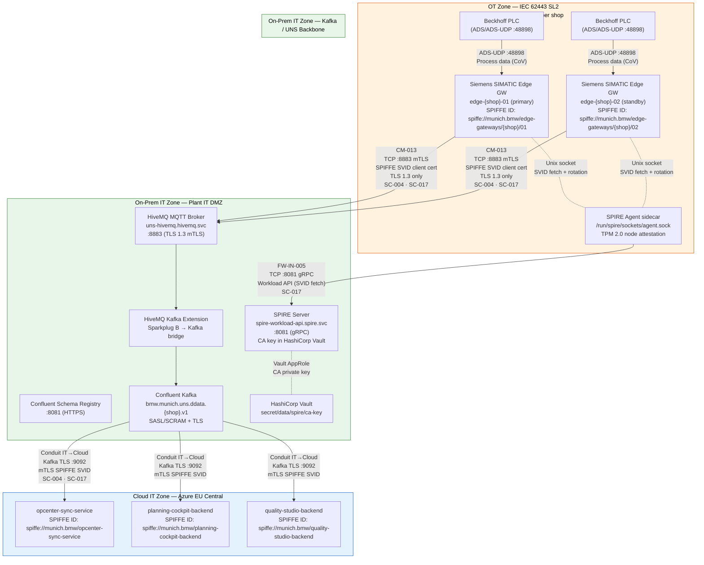

# Zone-and-Conduit Model — iFactoryOS OT/IT Network Segmentation

**Standard:** IEC 62443 Security Level 2 (SL2)
**Scope:** OT Zone (edge gateways / PLCs) → On-Prem IT Zone (UNS backbone) → Cloud IT Zone (ARO workloads)
**Audit reference:** US-027 · BR-10 · External IEC 62443 SL2 audit October 1, 2025

---

## Three-Zone Boundary Diagram

---

## Conduit Register

| Conduit ID | From | To | Protocol | Port | Auth Method | IEC 62443 Control | Direction |
|---|---|---|---|---|---|---|---|
| **CM-013** | OT Zone VLAN (10.200.x.0/24) | Plant IT DMZ — MQTT Broker | MQTT over TLS 1.3 | TCP/8883 | mTLS — SPIFFE X.509 SVID | SC-004, SC-017 | Egress (OT→IT) |
| **FW-IN-005** | OT Zone VLAN (10.200.x.0/24) | Plant IT DMZ — SPIRE Workload API | gRPC/TLS | TCP/8081 | SPIFFE Workload API (Unix socket relay) | SC-017 | Egress (OT→IT) |
| **IT→Cloud-001** | Plant IT DMZ — Kafka | Cloud IT Zone — ARO workloads | Kafka over TLS | TCP/9092 | mTLS — SPIFFE X.509 SVID | SC-004, SC-017 | Egress (IT→Cloud) |

---

## IEC 62443 SL2 Control Mapping

| Control | Description | Implementation |
|---|---|---|
| **SC-004** | Zone separation — no direct OT-to-Cloud path; all flows route through the IT DMZ conduit | NetworkPolicy `ot-vlan-egress-{shop}` blocks all egress except TCP/8883 (MQTT) and TCP/8081 (SPIRE). Physical enforcement via Palo Alto/Cisco firewall rule CM-013. |
| **SC-017** | Identification and authentication — mutual authentication on every conduit | SPIFFE/SPIRE-issued X.509 SVIDs on every TLS handshake. Certificates are TPM-attested (OT nodes) or k8s-psat-attested (IT nodes). 1-hour TTL, automated rotation at half-TTL via Workload API — no static certificates anywhere. |
| **SC-007** | Resource management — gateway availability | Primary + standby gateway per shop (10 total). 60-second local buffer survives connectivity loss; chronological FIFO replay on reconnect. |
| **SC-010** | Least privilege — Kafka ACLs | Each gateway SVID is authorised to write only to its own shop DDATA topic (`bmw.munich.uns.ddata.{shop}.v1`). |

---

## Trust Domain

All cross-zone identities share the single SPIFFE trust domain **`munich.bmw`** provisioned by the `spiffe-spire` module. No additional trust roots are introduced by this module.

- OT edge gateway SVID template: `spiffe://munich.bmw/edge-gateways/{shop}/{node_index}`
- MQTT broker SVID: `spiffe://munich.bmw/uns-backbone/mqtt-kafka-bridge`
- Kafka SVID: `spiffe://munich.bmw/uns-backbone/kafka`

Unauthenticated connection attempts to TCP/8883 are rejected at the TLS handshake by HiveMQ's mutual-TLS listener configuration (verified by `TestMtlsRejectsExpiredSvid` and `TestMtlsRejectsUntrustedCert` in `tests/test_mtls_spiffe.py`).
